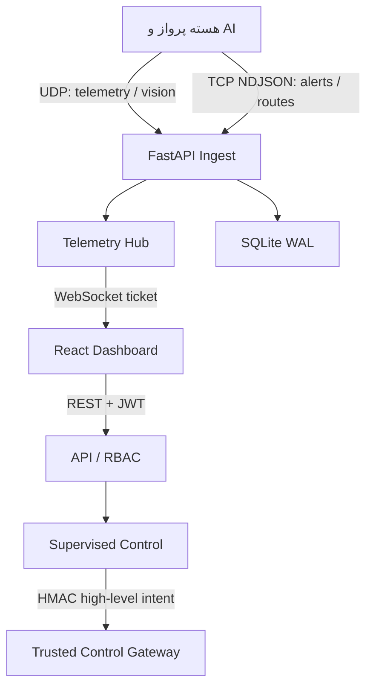

# معماری داشبورد عملیات پرواز

## مرز سامانه

این پروژه یک سرویس مستقل از هسته خودمختاری است. هسته پرواز، بینایی، تحلیل مسیر و ارزیابی ریسک فقط داده منتشر می‌کنند. مرورگر هیچ اتصال مستقیم UDP، TCP، MAVLink یا دسترسی به کنترلر پرواز ندارد.

## مسیرهای داده

| مسیر | کاربرد | رفتار در فشار | ماندگاری |
|---|---|---|---|
| UDP `15010` | تله‌متری، IMU/GPS تجمیع‌شده، بینایی و ارزیابی حالت | آخرین داده مهم است؛ افت بسته اندازه‌گیری می‌شود | نمونه‌برداری ۲ هرتز |
| TCP `15011` | هشدار، مسیرهای A*، سلامت ماژول و گزارش سناریو | ACK خطی برای هر پیام NDJSON | هشدارها کامل ذخیره می‌شوند |
| WebSocket `/ws/live` | تغذیه لحظه‌ای داشبورد | صف ۱۲۸ عضوی و `drop-oldest` | بدون ماندگاری مستقل |
| REST `/api/v1/*` | نشست، تاریخچه، چت و کنترل | پاسخ قابل حسابرسی | SQLite |

## نقش‌ها

| قابلیت | کارشناس پرواز | مدیر پرواز |
|---|---:|---:|
| مشاهده همه تله‌متری و بینایی | ✓ | ✓ |
| آغاز فرمان بحرانی | ✓ | — |
| تأیید فرمان بحرانی کارشناس | — | ✓ |
| تأیید هشدار | ✓ | ✓ |
| استفاده از دستیار مشورتی | ✓ | ✓ |

هیچ کاربری نمی‌تواند درخواست خودش را به‌عنوان تأیید دوم امضا کند. فرمان‌های بحرانی ۳۰ ثانیه اعتبار دارند.

## تأخیر

`sent_at_ms` از منتشرکننده و `received_at_ms` از سرور برای نمایش تأخیر استفاده می‌شوند. برای اندازه‌گیری معتبر، ساعت Jetson و هسته پردازش باید با Chrony/PTP همگام باشند. عدد UI بدون همگامی ساعت فقط شاخص تقریبی است. WebSocket هر پیام را بلافاصله منتشر می‌کند و در صورت کندی کلاینت، قدیمی‌ترین داده را حذف می‌کند تا تصمیم با داده کهنه گرفته نشود.

## کنترل و مدل

مدل فقط یکی از پیشنهادهای بسته `CONTINUE`, `REQUEST_SENSOR_UPDATE`, `REQUEST_REPLAN`, `HOLD`, `RETURN`, `LAND`, `ABSTAIN` را برمی‌گرداند. پاسخ دارای مختصات، waypoint، setpoint، MAVLink، PWM یا فرمان موتور در سد ایمنی مسدود می‌شود. پاسخ مدل هرگز ورودی `ControlService` نیست.

پنل کنترل فقط intent سطح‌بالا می‌سازد. حالت‌ها:

- `disabled`: همه فرمان‌ها رد می‌شوند.
- `simulation`: گردش کار کامل و ثبت ممیزی انجام می‌شود، ولی سخت‌افزار تغییر نمی‌کند.
- `gateway`: intent سطح‌بالا با HMAC و timeout دوثانیه‌ای به درگاه مورداعتماد ارسال می‌شود. پیاده‌سازی PX4/MAVSDK باید در پروژه جداگانه gateway، همراه geofence، failsafe و آزمون SITL باشد.

