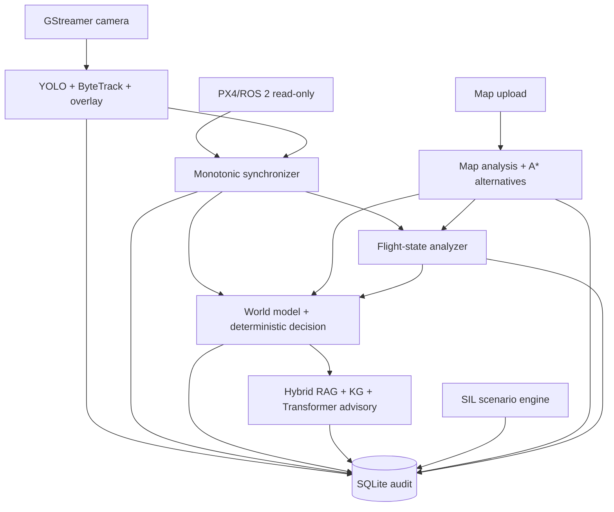

# سیم‌کشی نسخه 0.6.0-dev1

نسخه ۲ سیم‌کشی، مسیر تله‌متری را ابتدا از `temporal_guard` عبور می‌دهد و سپس وارد همگام‌ساز می‌کند. نقشه تحلیل‌شده نیز پیش از planner به `dynamic_risk_overlay` می‌رود. مسیر معتبر به‌طور مستقل توسط `route_revalidator` و `energy_estimator` پایش می‌شود و `health_manager` همراه `mission_assurance` گزارش نهایی قابل‌ممیزی می‌سازند. هیچ‌یک خروجی کنترلی یا PX4 publisher ندارند.

این نسخه یک clock domain مشترک از نوع `host_monotonic_ms` دارد. timestamp سنسور برای freshness خود سنسور حفظ می‌شود، اما تطبیق دوربین با GPS/IMU فقط با زمان monotonic همان میزبان انجام می‌شود تا تغییر ساعت سیستم باعث match اشتباه نشود.

## مسیر تصویر

| مبدأ | مقصد | قرارداد | سیاست صف | بودجه عمر |
| --- | --- | --- | --- | --- |
| GStreamer appsink | YOLO + ByteTrack | `CapturedBgrFrame.v1` | `drop_oldest` | 100 ms |
| YOLO + ByteTrack | Overlay | `TrackedObjects2D.v1` | `latest_only` | 100 ms |
| Overlay | GStreamer appsrc | `AnnotatedBgrFrame.v1` | `drop_oldest` | 150 ms |
| Tracker | SQLite | `TrackedObjects2D.v1` | `durable` | 10 s |

## مسیر همگام‌سازی و تصمیم

| مبدأ | مقصد | قرارداد | نقش |
| --- | --- | --- | --- |
| Camera clock | Synchronizer | `FrameClock.v1` | زمان capture |
| PX4 read-only | Synchronizer | `TelemetryFrame.v1` | GPS/IMU/Battery |
| Synchronizer | World Model | `SyncedObservation.v1` | فقط match با skew مجاز |
| World Model | Decision Engine | `WorldSnapshot.v1` | تصمیم قطعی محدود |
| Decision Engine | Hybrid RAG | `BoundedDecision.v1` | ساخت query مشورتی |
| RAG/KG | Transformer | `RagEvidenceBundle.v1` | evidence دارای provenance |
| Transformer | Evidence Gate | `AdvisoryProposal.v1` | پیشنهاد، نه فرمان |
| Operator/API | Map Ingest | `MapUpload.v1` | فایل محدود و allowlist‌شده |
| Map Analyzer | A* Planner | `AnalyzedMissionMap.v1` | occupancy/risk/elevation |
| A* Planner | Route Validator | `RouteCandidates3D.v1` | مسیر اصلی و جایگزین |
| Route Validator | Flight Analyzer | `ValidatedRoute3D.v1` | فقط مسیر معتبر |
| Synchronizer | Flight Analyzer | `SyncedObservation.v1` | وضعیت زنده پرواز |
| Flight Analyzer | Decision Engine | `FlightAssessment.v1` | اقدام محدود، بدون setpoint |

## قواعد اجرایی

- `appsink` یک buffer نگه می‌دارد و فریم قدیمی را drop می‌کند؛ application queue نیز حداکثر دو فریم دارد.
- هر track در `vision_objects` با `vision_frame_id` و `track_id` ذخیره می‌شود.
- هر فریم در `sensor_vision_sync` وضعیت `MATCHED`، `TOO_OLD` یا `MISSING` دارد.
- latency، queue depth و dropped count در `module_health_events` ثبت می‌شود.
- validator تطابق port/contract، producer یکتا و نبود مسیر advisory به flight-control/actuator را کنترل می‌کند.
- در این نسخه هیچ ماژول خروجی PX4 command، waypoint، setpoint یا actuator وجود ندارد.

منبع حقیقت سیم‌کشی ماشین‌خوان فایل `config/system.wiring.json` است؛ این سند فقط نمای انسانی همان قرارداد است.
