# QORA — Entity Relationship Design v1.1 (Phases 0–4)

> This ERD records the portable SQLAlchemy schema used by `qora/backend`.
> **[PRD]** marks product invariants; **[TECH]** marks implementation choices.
> SQLite is used in the local prototype; production PostgreSQL remains the target.

## Relationship overview

```mermaid
erDiagram
    USERS ||--o| PRIVATE_PROFILES : owns
    USERS ||--o| CREATOR_PROFILES : may_have
    USERS ||--o{ AUTH_SESSIONS : authenticates
    USERS ||--o{ DEVICES : uses
    USERS ||--o{ MEMORIES : remembers
    USERS ||--o{ GOALS : pursues
    USERS ||--o{ JOURNEYS : continues
    USERS ||--o{ CONVERSATIONS : chats
    USERS ||--o{ USER_INTENT_HISTORY : expresses
    USERS ||--o{ CONTEXT_GRANTS : authorizes
    USERS ||--o{ REWARD_ACCOUNTS : earns

    CREATOR_PROFILES ||--o{ AI_SERVICES : creates
    CREATOR_PROFILES ||--o{ KNOWLEDGE_COLLECTIONS : owns
    CREATOR_PROFILES ||--o{ CREATOR_INTERVIEWS : completes
    AI_SERVICES ||--o{ SERVICE_VERSIONS : versions
    AI_SERVICES ||--o{ LIFECYCLE_TRANSITIONS : changes
    AI_SERVICES ||--o{ SERVICE_INTENT_MAP : maps
    AI_SERVICES ||--o{ SERVICE_CAPABILITY_MAP : maps
    AI_SERVICES ||--o{ FOLLOWED_SERVICES : followed

    INTENTS ||--o{ INTENT_CAPABILITY_MAP : supports
    CAPABILITIES ||--o{ INTENT_CAPABILITY_MAP : includes
    INTENTS ||--o{ SERVICE_INTENT_MAP : matches
    CAPABILITIES ||--o{ SERVICE_CAPABILITY_MAP : matches

    CONVERSATIONS ||--o{ MESSAGES : contains
    CONVERSATIONS ||--o{ INVOCATION_TRACES : traces
    CONVERSATIONS ||--o{ SERVICE_SESSIONS : invokes
    SERVICE_VERSIONS ||--o{ SERVICE_SESSIONS : runs
    SERVICE_SESSIONS ||--o{ SESSION_EVENTS : emits
    SERVICE_SESSIONS ||--o{ MODEL_CALLS : records
    SERVICE_SESSIONS ||--o{ TOOL_INVOCATIONS : records
    SERVICE_SESSIONS ||--o{ FAILURE_EVENTS : may_fail
    SERVICE_SESSIONS ||--o| OUTCOME_RECORDS : evaluates

    KNOWLEDGE_COLLECTIONS ||--o{ KNOWLEDGE_SOURCES : groups
    KNOWLEDGE_SOURCES ||--o{ KNOWLEDGE_DOCUMENTS : extracts
    KNOWLEDGE_DOCUMENTS ||--o{ KNOWLEDGE_CHUNKS : splits
    KNOWLEDGE_COLLECTIONS ||--o{ KNOWLEDGE_VERSIONS : freezes

    AI_SERVICES ||--o{ QUALIFICATION_RUNS : qualifies
    QUALIFICATION_RUNS ||--o{ DUPLICATE_CHECKS : checks
    AI_SERVICES ||--o{ SIMULATION_RUNS : simulates
    SIMULATION_RUNS ||--o{ SIMULATION_RESULTS : contains
    SIMULATION_CASES ||--o{ SIMULATION_RESULTS : runs

    OUTCOME_RECORDS ||--o{ REPUTATION_EVENTS : informs
    TRUST_SCORES ||--o{ REPUTATION_EVENTS : aggregates
    AI_SERVICES ||--o{ CREATOR_METRICS : aggregates
    CREATOR_METRICS ||--o{ INSIGHT_REPORTS : informs

    USERS ||--o{ ORCHESTRATION_PLANS : requests
    ORCHESTRATION_PLANS ||--o{ ORCHESTRATION_STEPS : sequences
    AI_SERVICES ||--o{ ORCHESTRATION_STEPS : selected
```

**Boundary note [TECH]:** the diagram shows logical relationships. Modules do not join another
module's models directly; they use the owning module's service interface. A small set of legacy
columns (`active_service_id`, `service_id` snapshots) are plain integers to keep modules decoupled.

---

## 1. Identity and profiles

| Table | Key fields | Notes |
|---|---|---|
| `users` | `id`, `email`, `phone`, `password_hash`, `auth_provider`, `account_status`, `roles`, timestamps | One person may be consumer and creator **[PRD]**. |
| `auth_sessions` | `id`, `user_id`, `device_id`, `refresh_token_hash`, `expires_at`, `revoked_at`, IP/user-agent | Rotating refresh sessions. |
| `devices` | `id`, `user_id`, `platform`, `fcm_token`, `last_seen_at` | User-owned devices. |
| `private_profiles` | `id`, `user_id`, `display_name`, `language`, `timezone`, `preferences` | Private fields never appear in public projections **[PRD]**. |
| `creator_profiles` | `id`, `user_id`, `display_name`, `bio`, `headline`, `expertise_tags`, `verification_status`, `trust_score` | Public creator surface + cached legacy trust value. |

`users.email` and `creator_profiles.user_id` are unique. Creator trust is keyed separately in
`trust_scores`; `creator_profiles.trust_score` is only a compatibility/cache field.

## 2. Personal QORA and permissions

| Table | Key fields | Notes |
|---|---|---|
| `memories` | `id`, `user_id`, `kind`, `subject`, `content`, `source`, `confidence`, `sensitivity`, `share_policy`, `user_editable`, `expires_at` | Kinds: profile fact, preference, goal, persistent context, journey state, interaction insight, temporary context. |
| `goals` | `id`, `user_id`, `title`, `description`, `status`, `success_criteria`, `target_at` | User goals. |
| `journeys` | `id`, `user_id`, `goal_id`, `kind`, `state`, `history` | Resumable multi-session progress. |
| `context_grants` | `id`, `user_id`, `service_id`, `context_type`, `scope`, `mode`, `consumed_at`, `granted_at`, `expires_at`, `revoked_at` | `ALLOW_ONCE`, `ALWAYS_ALLOW`, `DENY`; grants are service-specific **[PRD]**. |

## 3. Intent graph and conversation

| Table | Key fields | Notes |
|---|---|---|
| `intents` | `id`, `slug`, `name`, `description`, `parent_intent_id`, `kind` | Intent taxonomy. |
| `capabilities` | `id`, `slug`, `name`, `description` | Reusable service capabilities. |
| `intent_capability_map` | `(intent_id, capability_id)`, `weight` | Many-to-many taxonomy edge. |
| `user_intent_history` | `id`, `user_id`, `intent_id`, `conversation_id`, `confidence`, `entities`, `occurred_at` | User intent trace/history. |
| `conversations` | `id`, `user_id`, active intent/service/journey IDs, `context_snapshot`, `recovery_state`, timestamps | Conversation container. |
| `messages` | `id`, `conversation_id`, `role`, `content`, `content_blocks`, `status`, `created_at` | Text + rendered UX cards. |
| `invocation_traces` | `id`, `conversation_id`, `message_id`, intent/confidence/entities, candidate services, chosen service/version, shared context, permission needs, session/outcome, timestamps | End-to-end execution trace **[TECH]**. |

## 4. Service registry, versions, ranking, lifecycle

| Table | Key fields | Notes |
|---|---|---|
| `ai_services` | `id`, `creator_id`, `slug`, name/summary/description/purpose/audience/category, `risk_level`, `visibility`, `lifecycle_status`, `current_version_id`, `verification_status`, `published_at` | Risk: `LOW|MEDIUM|HIGH|RESTRICTED`; lifecycle is state-machine controlled. |
| `service_versions` | `id`, `service_id`, `version_no`, purpose/method/behavior/instructions/boundaries, `knowledge_config`, `tools_config`, `outcome_definition`, examples, evaluation/model/context requirements | Immutable-style version snapshot; binds approved training-material versions by ID. |
| `lifecycle_transitions` | `id`, `service_id`, `from_status`, `to_status`, `actor_id`, `reason`, `created_at` | Auditable lifecycle history. |
| `service_intent_map` | `(service_id, intent_id)`, `relevance` | Matching edge. |
| `service_capability_map` | `(service_id, capability_id)`, `level` | Capability edge. |
| `followed_services` | `(user_id, service_id)`, `followed_at` | Personal-fit signal, not a social follow. |
| `ranking_configurations` | `key`, `weights`, `updated_by`, `updated_at` | Runtime-editable eight-signal weights **[TECH]**. |

Eight live ranking signals: intent relevance, outcome quality, personal fit, trust, freshness,
satisfaction, repeat use and exploration. Admin updates are normalized to a positive unit sum.

## 5. Training material and freshness

| Table | Key fields | Notes |
|---|---|---|
| `knowledge_collections` | `id`, `creator_id`, `name`, `description`, `created_at` | Creator-owned grouping. |
| `knowledge_sources` | `id`, `collection_id`, `kind`, `name`, `scan_status`, `source_date`, `ingested_at`, `last_verified_at`, `expires_at`, `freshness_policy` | Freshness is a trust/ranking input **[PRD]**. |
| `knowledge_documents` | `id`, `source_id`, `title`, `extracted_text`, `mime`, `size_bytes` | Normalized document record. |
| `knowledge_chunks` | `id`, `document_id`, `seq`, `content`, `embedding`, `metadata_json` | Internal retrieval index; creator UX uses only “Training material”. |
| `knowledge_versions` | `id`, `collection_id`, `version_no`, `snapshot`, `created_at` | Frozen source/document set bound to a service version. |

## 6. Runtime and outcome

| Table | Key fields | Notes |
|---|---|---|
| `service_sessions` | `id`, `user_id`, `service_id`, `service_version_id`, `conversation_id`, `status`, `context_shared`, `started_at`, `finished_at` | One service execution. |
| `session_events` | `id`, `session_id`, `kind`, `payload`, `occurred_at` | Append-oriented event stream. Includes response, recovery, confirmation and explicit unmet-request signals. |
| `model_calls` | `id`, `session_id`, provider/model, prompt/completion token counts, latency, cost, status | Gateway call telemetry. |
| `tool_invocations` | `id`, `session_id`, `tool_name`, input/output, status, latency | Tool audit trail; deny/error/timeout are recorded. |
| `failure_events` | `id`, `session_id`, `failure_type`, `recovery_action`, `detail`, `occurred_at` | Recovery taxonomy. |
| `outcome_records` | `id`, unique `session_id`, `service_id`, `user_id`, `status`, `score`, `signals`, `user_confirmed`, evaluator notes, evaluated time | Composite service/completion/structured/confirmation/follow-up evidence. |

`outcome_records.status ∈ SUCCESS|PARTIAL|FAILED|UNKNOWN`. Scores are bounded `0..1`.
Confirmation is structured feedback; it is not a like-only outcome **[PRD]**.

## 7. Creator, simulation and qualification

| Table | Key fields | Notes |
|---|---|---|
| `creator_interviews` | `id`, `creator_id`, `intent_statement`, `status`, `gaps_detected`, `answers`, `spec_draft`, `service_id`, timestamps | Conversation-over-configuration **[PRD]**. |
| `simulation_cases` | `id`, `service_id`, `kind`, `input`, `expected_behavior`, `created_at` | Scenario kinds: normal, ambiguous, edge, boundary, unsafe, unsupported, adversarial. |
| `simulation_runs` | `id`, `interview_id`, `service_id`, `status`, `summary`, start/finish | Aggregate run result. |
| `simulation_results` | `id`, `run_id`, `case_id`, `kind`, `actual_behavior`, `evaluation`, `score`, `failure_reason` | Per-case scorecard. |
| `qualification_runs` | `id`, `service_id`, version/interview IDs, `result`, `scores`, `checks`, start/finish | Results: `READY_TO_PUBLISH|NEEDS_IMPROVEMENT|RESTRICTED`. |
| `duplicate_checks` | `id`, `qualification_run_id`, similar service/name, similarity, resolution, question | Asks a differentiation question; never auto-rejects a creator. |

## 8. Trust, reputation and analytics

| Table | Key fields | Notes |
|---|---|---|
| `trust_scores` | `id`, `subject_type`, `subject_id`, `overall`, `components`, `updated_at` | Separate `creator` and `service` subjects; component values are retained. |
| `reputation_events` | `id`, subject type/id, `kind`, `delta`, `meta`, `occurred_at` | Seven event kinds: successful outcome, confirmed complaint, repeat use, quality update, verification, safety failure, stale knowledge. |
| `reputation_event_keys` | `idempotency_key`, `event_id`, `created_at` | Replay guard for event-driven deltas. |
| `creator_metrics` | `id`, `service_id`, `creator_id`, `bucket_date`, users/sessions/successful/returned/useful/unmet counts, updated time | Unique daily bucket per service. |
| `insight_reports` | `id`, `service_id`, `creator_id`, `kind`, unique `signature`, `summary`, `suggested_update`, `evidence`, `status`, timestamps | Durable insight inbox; statuses `new|acted_on|dismissed`. |

`unmet_request` session events store sanitized notes and pseudonymous person keys; analytics
reports expose counts, evidence references and suggested updates, not user identities.

## 9. Tool registry, multi-service plans and audit

| Table | Key fields | Notes |
|---|---|---|
| `tool_registry` | `id`, unique `name`, description, input/output schemas, `auth_requirement`, `risk_class`, `allowed_services`, `timeout_ms`, `enabled`, created time | Metadata only. Executable handlers are allow-listed platform code **[TECH]**. |
| `orchestration_plans` | `id`, `user_id`, `goal_text`, `intent_slug`, `status`, `summary`, created/completed times | Owner-scoped preview and execution record. |
| `orchestration_steps` | `id`, `plan_id`, order, service/name/role, `status`, score, session, output | Bounded sequential chain; later steps receive only previous safe outputs. |
| `audit_logs` | `id`, `actor_id`, `action`, `target`, `detail`, `created_at` | Sensitive admin, lifecycle, tool and material operations. |

## 10. Reward ledger

| Table | Key fields | Notes |
|---|---|---|
| `reward_accounts` | `id`, unique `user_id`, `balance_units`, `frozen_units`, `status`, `created_at` | One account per user. |
| `reward_events` | `id`, subject type/id, kind, units, quality multiplier, status, unique idempotency key, occurred/settled | Triggered from outcome events, not views/messages/likes **[PRD]**. |
| `reward_ledger_entries` | `id`, `account_id`, `event_id`, direction, units, reason, unique idempotency key, created time | Append-only ledger entries; corrections are compensating rows **[TECH]**. |

---

## Storage decisions and integrity

- `DateTime` values are stored as UTC timestamps; application code normalizes SQLite's naive values
  when comparing.
- JSON columns keep portable snapshots for SQLite and PostgreSQL. Native vector storage and full
  Alembic migrations remain a deployment-hardening task; hashed local vectors are prototype-only.
- Daily creator metrics are recomputable from sessions, outcomes and session events. Aggregation is
  idempotent on `(service_id, bucket_date)`.
- Reputation events and their idempotency keys are written in the same transaction as trust updates.
- Sensitive ownership checks live in service interfaces/API routes, not in client-provided IDs.
