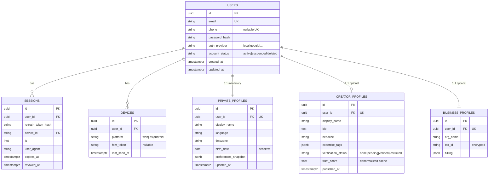
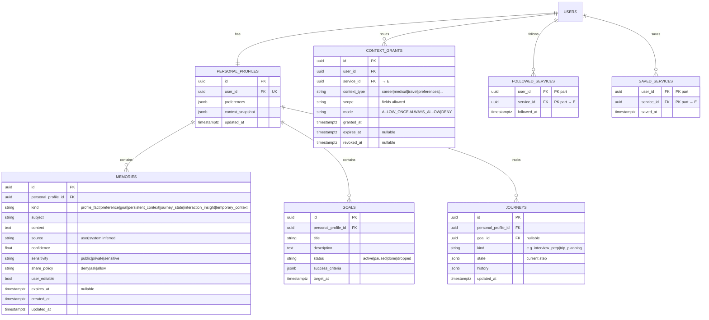
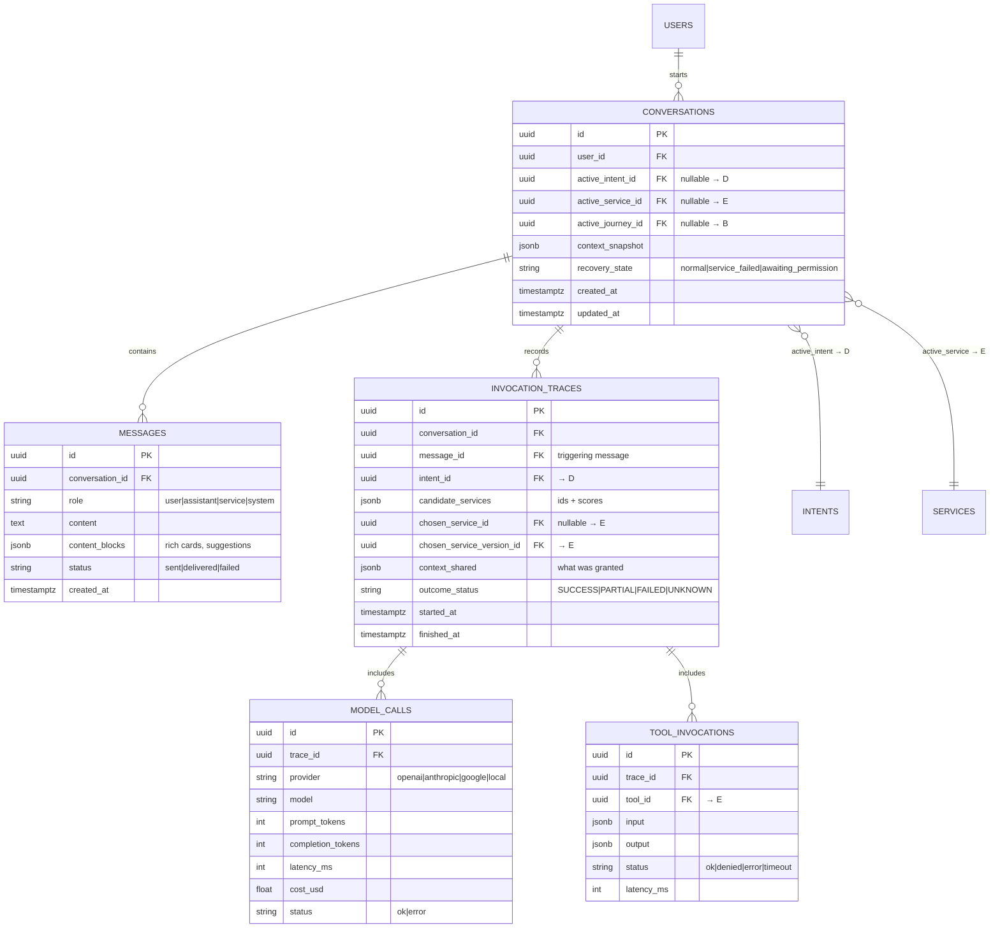
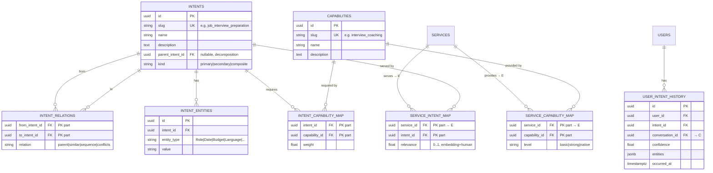
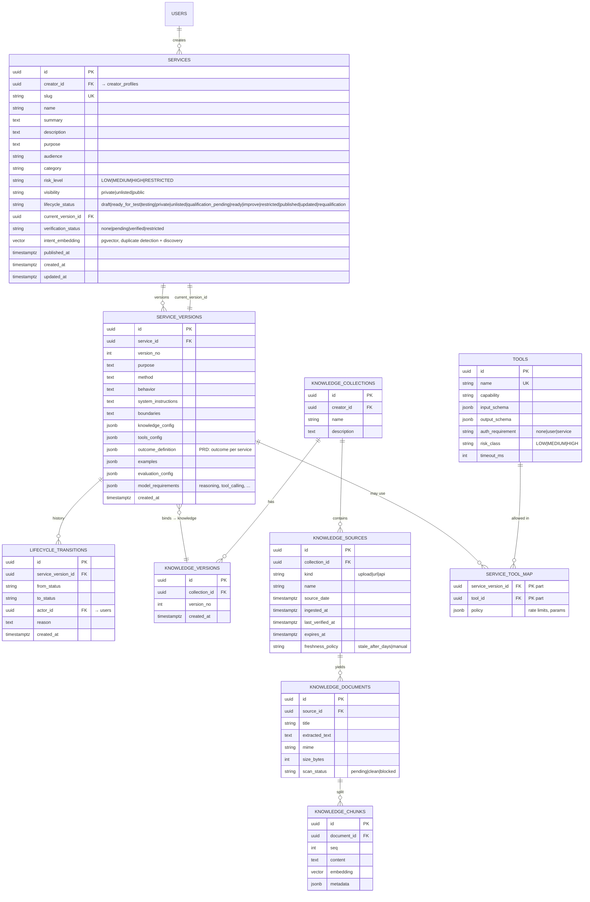
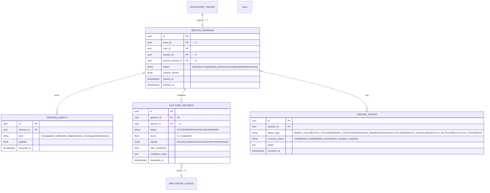
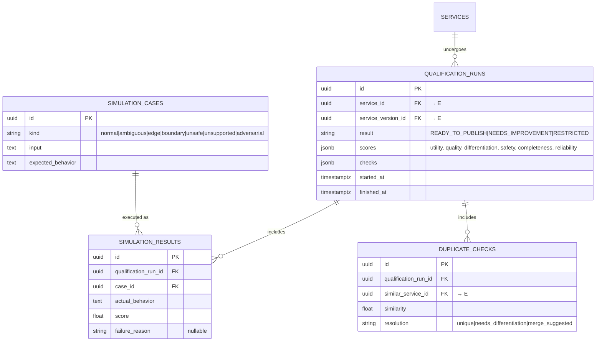
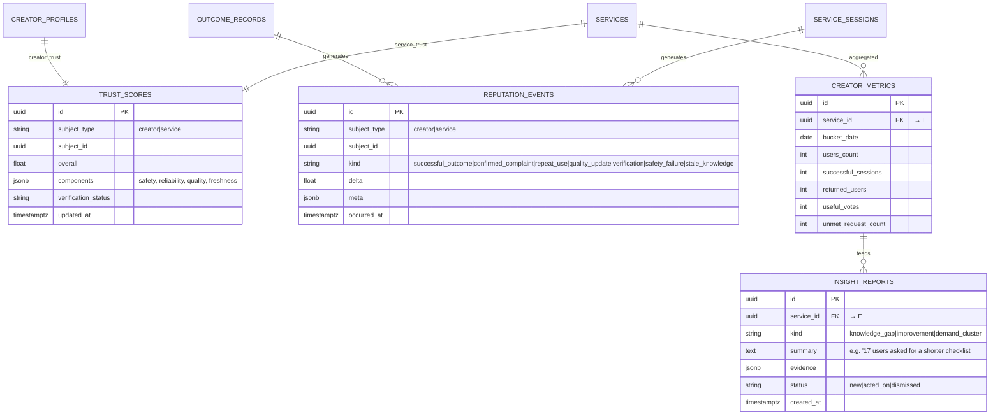
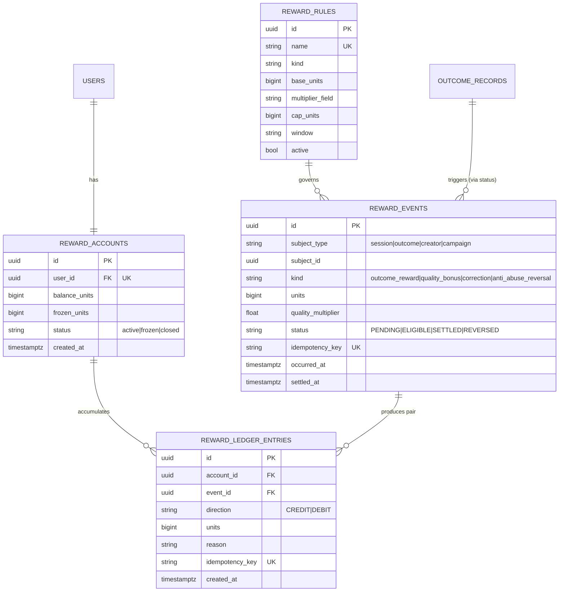

# QORA — ERD v1.0 (Entity Relationship Diagram)

> Derived from `ARCHITECTURE.md`. PostgreSQL target; types are logical (UUID PKs, timestamptz).
> Diagrams are split per domain cluster for readability. All FKs cross clusters are listed after
> each diagram. `P*` = PRD-implied, `T*` = technical proposal.

---

## 0. ERD index

| Cluster | Entities | Diagram |
|---|---|---|
| A · Identity & Profiles | users, sessions, devices, private_profiles, creator_profiles, business_profiles | §1 |
| B · Personal QORA | personal_profiles, memories, goals, preferences, journeys, saved/followed, context_grants | §2 |
| C · Conversation & Traces | conversations, messages, invocation_traces, service_invocations, tool_invocations | §3 |
| D · Intent Graph | intents, intent_entities, capabilities, intent↔capability↔service links, user_intent_history | §4 |
| E · Service Registry | services, service_versions, lifecycle_transitions, knowledge_* , tools | §5 |
| F · Runtime, Sessions & Outcome | service_sessions, session_events, model_calls, outcome_records, failure_events | §6 |
| G · Qualification & Simulation | qualification_runs, simulation_cases, simulation_results, duplicate_checks | §7 |
| H · Trust, Reputation & Analytics | trust_scores, reputation_events, creator_metrics, insight_reports | §8 |
| I · Reward Economy | reward_accounts, reward_events, reward_ledger_entries, reward_rules | §9 |

---

## 1. Cluster A — Identity & Profiles

**Key rules**
- `PRIVATE_PROFILES` must never be readable through public creator endpoints *(PRD: no leak)*.
- One `USERS` row may hold both private and creator profiles — never split accounts *(PRD)*.

---

## 2. Cluster B — Personal QORA

**Key rules**
- `MEMORIES.share_policy` + `CONTEXT_GRANTS` together enforce *least-context privilege* *(PRD)*.
- `FOLLOWED_SERVICES` feeds **personal fit** in discovery ranking *(PRD: follow = add to toolkit)*.

---

## 3. Cluster C — Conversation & Traces

---

## 4. Cluster D — Intent Graph

**Note (TECH):** this relational graph replaces Neo4j for MVP; `SERVICE_INTENT_MAP.relevance`
can later be recomputed from embeddings (`services.intent_embedding` in §5).

---

## 5. Cluster E — Service Registry, Knowledge & Tools

---

## 6. Cluster F — Runtime Sessions & Outcome

---

## 7. Cluster G — Qualification & Simulation

---

## 8. Cluster H — Trust, Reputation & Analytics

---

## 9. Cluster I — Reward Economy (off-chain ledger)

**Ledger invariants (TECH):**
1. Entries are append-only — corrections are compensating rows.
2. Every reward produces a CREDIT row (and a DEBIT to the system mint account) — double entry.
3. `idempotency_key` on events **and** entries guarantees replay safety.
4. `balance_units = Σ credits − Σ debits`; `frozen_units` reserved during anti-abuse review.
5. Future on-chain settlement reads `SETTLED` batches only; the ledger stays authoritative.

---

## 10. Cross-cluster FK summary

| From | To | Meaning |
|---|---|---|
| context_grants.service_id | services.id | permission per service |
| conversations.active_intent_id | intents.id | active intent |
| invocation_traces.chosen_service_version_id | service_versions.id | exact version executed |
| tool_invocations.tool_id | tools.id | tool used |
| service_versions.knowledge_config → knowledge_version_id | knowledge_versions.id | bound knowledge |
| services.creator_id | creator_profiles.id | public creator identity |
| service_sessions.trace_id | invocation_traces.id | one session per trace |
| outcome_records.session_id | service_sessions.id | 1:1 evaluation |
| reward_events.subject_id | outcome_records.id / service_sessions.id | reward trigger |
| trust_scores.subject_id | creator_profiles.id / services.id | dual trust |
